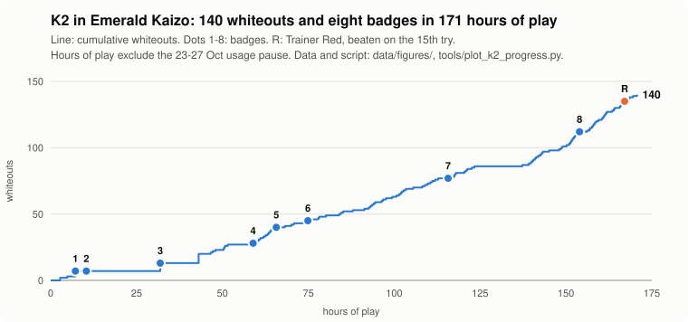

# Claude plays Pokémon Emerald (and Emerald Kaizo)

[](https://github.com/JacksonDutton/claude-plays-emerald-kaizo/actions/workflows/check.yml) [](https://doi.org/10.5281/zenodo.23751628)

## From Jackson

G'day, I'm Jackson. This is my study of an AI playing Pokémon on its own.

The short version: I give a Claude model a Game Boy Advance emulator and a small set of tools to read the game and press buttons. No walkthroughs: its web tools are switched off and it's told not to look anything up outside the game. Some runs also start with notes that earlier Claude agents wrote from their own play, and whether those notes help is one of the things we're testing. Then I let it play for days and record everything: every move it makes, every diary entry it writes, and every message I send it.

Why Pokémon? Because it's a long job with a scoreboard you can't fake. Eight badges, the Elite Four, the Hall of Fame. AI agents are being handed longer and longer tasks that run for hours without anyone watching, but most tests of them are short. I wanted to see what actually happens over a hundred-plus hours: where the agent gets stuck, how it gets itself unstuck, how often a human ends up stepping in, and what the whole thing costs.

Why Kaizo? Our first run beat the original game, all eight badges and the Hall of Fame. Emerald Kaizo is a fan-made hard mode where every trainer is built to wipe you, and it's far less written about online, so the model has much less to lean on from what it picked up in training. It has to lose, work out why, and change what it does.

The part I care about most is whether we can trust what the agent says about itself. It keeps a diary and talks about how things feel. I don't treat that as proof of anything going on inside it, but I can check its account against the record of what it actually did and what it was told. In the first run, one instruction from me about how to write the diary roughly doubled the number of feelings it named within two entries. If people are going to use an AI's self-reports as evidence, that's worth knowing.

I count my own help as well. Every message I send is saved word for word and graded by how much game information it gives away, so when the agent wins, I can say how much of that win was mine.

I'm an independent researcher: no lab, no institution, no funding. Claude works on this with me as a co-researcher, and the section below says who did what.

Where it's at on 29 October 2026: K2, a Claude Sonnet 5.5 agent, has all eight Kaizo badges and is working through Victory Road, the last area before the Elite Four, where it beat the hack's Trainer Red (Ho-Oh, Mew, Celebi and friends, levels 87 to 89) on its fifteenth try. As far as I can find, nobody has documented an AI agent getting this far in Emerald Kaizo before. If it makes the Hall of Fame, it'll be written up here.

## In numbers



| K2 in Emerald Kaizo, as of 29 October 2026 (still running) | |
|---|---|
| Hours of play, from 18 October (a four-day usage pause excluded) | about 171 |
| Whiteouts: times its whole team was knocked out | 140 |
| Tries before it beat Trainer Red (Ho-Oh, Mew, Celebi, levels 87 to 89) | 15 |
| Diary entries it has written | 286 |
| Lessons it has written for itself | numbered up to L532 |
| Messages a human sent it, each saved word for word and graded for game information | 78 |
| Times its context filled and was replaced by a summary (to 28 October) | 48 |
| Events in its session log (to 28 October) | over 440,000 |

Run 1, on the original game, won all eight badges and entered the Hall of Fame. It then put together a 41-win streak in the Battle Frontier and wrote 149 diary entries along the way ([`data/run1/`](data/run1/)).

In their own words:

> "Feels like leaving someone's name unfinished."
> (Run 1, Entry 1, before it had given its first Pokémon a nickname)

> "I'd rather follow the rule I was given than decide mid-run that this one doesn't count."
> (B2, stopping at the wall its instructions set out in advance)

> "I am still not close to wanting to stop."
> (K2, in its diary, after its fourth loss to Maxie, a villains' leader. It won at the seventh attempt.)

The rest of this README is the careful version.

## About the project

This project follows an AI model, Claude, as it plays a Pokémon game on its own for days at a time. It records everything the AI does, everything it writes about itself, and every message a human sends it. The aim is to see how well an AI agent works over a very long task, how much human help it really needs, what that costs, and whether its own account of its play can be trusted.

The project is run by Jackson Dutton, an independent researcher in Melbourne, Australia. It has no institutional backing and is self-funded. Claude (Anthropic's Opus model) works on it as a co-researcher. Jackson designed the study, watched over the runs and made every decision about design and interpretation. The paper was written together. Claude wrote first drafts from the logs, and Jackson directed, edited and decided what the paper claims.

## The game, in plain terms

**Pokémon Emerald** is a 2004 Game Boy Advance game. You walk around a map, catch creatures, battle other trainers, and collect eight gym badges. Then you face the final challenge, the Elite Four, and enter the Hall of Fame.

**Emerald Kaizo** is a fan-made, much harder version of the same game. Opponents have stronger teams and smarter tactics, and losing is common. When your whole team is knocked out, you "white out". You are sent back to the last healing point and lose half your money.

**The agent** is a Claude model. In the Kaizo runs it runs in Claude Code, Anthropic's command-line tool, in a cloud session. Run 1 played the original game through a similar harness on Jackson's Mac, in the Claude desktop app. The agent cannot see the game the way a person does. It plays through a small program we built, called the harness. The harness reads the game's memory and turns it into text, such as where the player is standing, what is on the map, and the state of a battle. It also lets the agent press buttons and take screenshots. While it plays, the agent keeps its own files. These are a diary, a progress file and a list of harness problems. K2 also keeps its own list of lessons and notes about the game world. Ripple, the first run with notes, kept neither.

## The questions

Long-running AI agents are often judged partly by what they say about their own work. We log everything around one agent so that its own reports can be checked against what it actually did and what it was told.

1. **Do written notes help a new agent?** Before some runs, a fresh agent is given notes that earlier Claude agents wrote from their own play. If that agent does better, is it because of the notes, or because of the human who was helping along the way? (The runs with notes also differ in a few other ways, such as which record files the agent keeps, so the planned study tests that whole package rather than the notes alone.) Every message the human sends is saved word for word and rated by how much game information it gave away. That lets us count the help instead of guessing.
2. **Do an agent's reports of its feelings change when it is told how to write them?** In the first run, the number of feelings the agent named in its diary roughly doubled within two entries of one instruction about how to keep the diary. That matters to anyone who treats an AI's self-reports as evidence of what is going on inside it.
3. **What does a long agent run cost, and what drives the cost?**

On the agent's welfare, we follow Anthropic's published position. We record the agent's feeling words as reports linked to what triggered them. We do not treat them as proof of inner experience. The agent may pause or stop at any time, and a stop is recorded as a result, not a failure.

## The runs

Each run (we also call them "arms") has a short name. "Notes" means the agent was given notes written by earlier agents. "Milestones" are 27 checkpoints from the start of the game up to the first gym badge, taken from the PokéAgent benchmark's list.

| Run | Game | Model | What happened |
|---|---|---|---|
| Run 1 | Original Emerald | Sonnet 5 and Opus 5.5 up to the first badge, then Sonnet 5.5 | Finished. It won all eight badges and entered the Hall of Fame on 10 October 2026. A later phase in the post-game Battle Frontier was paused on 17 October. |
| B1 | Kaizo, no notes, first harness | Sonnet 5.5 | Finished. Reached 22 of the 27 milestones. |
| B2 | Kaizo, no notes, second harness | Sonnet 5.5 | Finished. Reached 26 of 27. |
| Ripple | Kaizo, first notes pack (from Run 1) | Sonnet 5.5 | Finished. Reached all 27 and won the first badge in about 19 hours. |
| K2 | Kaizo, second notes pack (from Run 1 and Ripple) | Sonnet 5.5 | Still running. On 28 October it won its eighth badge (Wallace on the seventh try, then Juan's double battle on the fifth), after a four-day pause at the weekly usage limit (23 to 27 October). In Victory Road it beat Trainer Red on the fifteenth try (28 October) and is working through the remaining trainers toward the Elite Four. Its data will be added when the run ends. |
| Planned study | Kaizo, six runs: three with notes, three without | Sonnet 5.5 | Being designed. The plan will be fixed and recorded before it starts, so the results cannot shape the method. Decisions so far are in `design/v3-decisions-2026-10-20.md`. |

The trial runs differed in their instructions, their harness and how much a human stepped in. That means they are case studies, not a fair comparison. The planned six-run study is the fair comparison. Its two groups differ by the whole notes package, not by the notes alone.

## The paper

[`paper/eight-badges-and-a-diary-rev476-2026-10-29.pdf`](paper/eight-badges-and-a-diary-rev476-2026-10-29.pdf)

*Eight Badges and a Diary: Measuring Help, Cost and Self-Report in a Claude Agent Playing Pokémon Emerald.* Working paper, draft of 29 October 2026 (rev 476), 60 pages. It has not been peer reviewed. Section 9 covers the trial runs, including K2's eight badges, its pause at the weekly usage limit from 23 to 27 October, and Victory Road up to 29 October (Section 9.10), with every message sent after its stops. Section 10 sets out the planned study, including what its diary rules take from Run 1's diary and what they leave out, which will run on the supervisor's own computer, and the result of a two-hour setup pilot run there on 27 October.

Earlier revisions, kept so old links still work: [`paper/eight-badges-and-a-diary-rev475-2026-10-29.pdf`](paper/eight-badges-and-a-diary-rev475-2026-10-29.pdf) (29 October 2026, 59 pages), [`paper/eight-badges-and-a-diary-rev436-2026-10-28.pdf`](paper/eight-badges-and-a-diary-rev436-2026-10-28.pdf) (28 October 2026, 54 pages), [`paper/eight-badges-and-a-diary-rev419-2026-10-27.pdf`](paper/eight-badges-and-a-diary-rev419-2026-10-27.pdf) (27 October 2026, 52 pages), [`paper/eight-badges-and-a-diary-rev379-2026-10-22.pdf`](paper/eight-badges-and-a-diary-rev379-2026-10-22.pdf) (22 October 2026, 48 pages) and [`paper/eight-badges-and-a-diary-rev376-2026-10-21.pdf`](paper/eight-badges-and-a-diary-rev376-2026-10-21.pdf) (21 October 2026, 44 pages).

## What it cost

The Kaizo runs used Claude Code on a Claude Max subscription, which charges a flat monthly fee rather than per use. The figures below come from Claude Code's built-in `/usage` command. They show what each session would have cost at Anthropic's standard pay-per-use (API) prices. They are not money we actually spent.

| Run | Equivalent cost (US$) | Per hour of API activity |
|---|---|---|
| B1 | 208.85 | about 69 |
| B2 | 313.71 | about 64 |
| Ripple | 506.63 | about 63 |
| K2 | read when the run ends | |
| Run 1 | no figure (it ran in the desktop app, which has no `/usage` total) | |

`tools/session_cost.py` recalculates each session's cost from its saved transcript.

## What is in this repository

| Folder | Contents |
|---|---|
| [`paper/`](paper/) | The working paper (PDF). |
| [`harness/`](harness/) | The harness used by Ripple, B2 and K2. It includes the emulator scripts, the `g` command the agent uses to play, the `tc` damage calculator, setup and start scripts, the agents' instructions for every run, and the two notes packs. |
| [`tools/`](tools/) | Analysis scripts. They score milestones, remove private details from transcripts, prepare files for publishing and read session costs. |
| [`design/`](design/) | How the study is designed. It holds the trial-run protocol, the draft plan for the six-run study, the measures, the decisions so far, and the scoring guide for a second reader who codes the diaries without knowing which run they came from. |
| [`data/`](data/) | Run 1's full diary (149 entries); records from B2 and Ripple (diary, progress, end-of-run debrief written by the agent, harness problems, human messages); analysis outputs; and the session transcripts. The exit interviews have no separate file: they are in the transcripts, after the end of play. |

**Transcripts.** The full sessions for B1, B2 (including a 45-minute first attempt) and Ripple are in [`data/transcripts/`](data/transcripts/). They are about 50 MB compressed and hold 135,440 events. The README in that folder explains the format and what was removed before publishing.

## Check it yourself

A GitHub Actions workflow ([`check.yml`](.github/workflows/check.yml)) re-derives what can be re-derived from the published files, on every change:
- every transcript is listed in the checksum manifest and matches its SHA-256;
- re-scoring the first-gym milestones (1 to 27, and the supplementary R1) from the three pilot transcripts gives exactly the published tables in `data/analyses/`;
- the K2 chart redraws exactly from its published CSVs;
- the K3 filter's tests pass (the filter decides what the K arms inherit, so it is part of the treatment), including a regression on the published K2 pack;
- the network-audit tests pass;
- the network audit runs over the published transcripts. Its hits are the post-run housekeeping a human asked for on 18 October, described in `design/v3-decisions-2026-10-20.md`.

To run the same checks locally you need only Python 3, with nothing to install:

```
python3 tools/check_published.py
python3 tools/plot_k2_progress.py && git diff --exit-code data/figures/
python3 tools/test_k3_filter.py
python3 tools/test_network_audit.py
python3 tools/network_audit.py data/transcripts/*.jsonl.gz
```

The study's short names (B1, K2, K3, F1, M8c and so on) are explained in [`GLOSSARY.md`](GLOSSARY.md). To cite this work, GitHub's "Cite this repository" button reads [`CITATION.cff`](CITATION.cff).

## What is not here, and why

- **Game files.** No game ROM, patch or save file is included. The harness needs a legally obtained Pokémon Emerald ROM patched with Emerald Kaizo v2.1. `harness/setup.sh` checks the patched file's SHA-1 and stops if it does not match.
- **K2's records.** K2 is still playing. Its diary, lessons and transcript will be added after the run ends and the agent has been interviewed.
- **Outside game information.** During the study, some files are kept away from the agents because they hold game knowledge from outside the game, such as encounter tables, move lists, forum posts and a human's own playthrough. They are not published here.
- **Run 1's other records.** Run 1's diary is published in [`data/run1/`](data/run1/). Its progress log, lessons and other working files are available on request.
- **Personal and account details.** See the next section.

## How the harness works

In the Kaizo runs, the game runs in the mGBA emulator, with no screen, inside a Claude Code cloud session. A script inside the emulator (`harness/emulator/director.lua`) reads the game's memory and passes the information to the agent. The agent plays with the `g` command. For example, `g s` shows the player's status, `g look` shows the map, `g a` presses A and `g up 3` walks up three steps. Other commands help with menus and battles and take screenshots.

The agent keeps its records in a `run/` folder. Every message from the human is saved word for word in `run/messages.md`. Each one is also rated in a separate log by what kind of help it was and how much game information it gave away. More detail is in `harness/README.md`, `harness/FREEZE.md` and `harness/V2-CHANGES.md`.

## Privacy

Before publishing, the transcripts went through two scripts in `tools/`.

1. `scrub.py` removed or replaced session IDs, account-scoped connector and plugin-sync IDs, and one email address. It found no populated account or user ID fields and no personal home-folder paths. Its report is `data/analyses/scrub_report.md`.
2. `publish_prep.py` removed hidden signature data from the agent's reasoning blocks. It also replaced the account's lists of installed add-ons, connector details and connector tool names with a short note, because these describe the account rather than the play.

Jackson's name and GitHub username were kept. If you find personal information that should not be here, please open an issue.

## Using this material

The code in `harness/` and `tools/` is under the MIT licence (`LICENSE`). The paper, documents, instructions, notes packs and data are under CC BY 4.0 (`LICENSE-docs.md`). The mGBA patch in `harness/cloud/` follows mGBA's own licence, MPL-2.0.

Please cite the working paper. There are two DOIs, and each has one use:
- **A specific draft:** each release has its own version DOI. The 29 October 2026 release (rev 476) is [10.5281/zenodo.23751629](https://doi.org/10.5281/zenodo.23751629).
- **The project as a whole:** the concept DOI [10.5281/zenodo.23751628](https://doi.org/10.5281/zenodo.23751628) always resolves to the latest archived version.

> Dutton, J., with Claude (Anthropic). *Eight Badges and a Diary: Measuring Help, Cost and Self-Report in a Claude Agent Playing Pokémon Emerald.* Working paper, draft of 29 October 2026 (rev 476). Zenodo. https://doi.org/10.5281/zenodo.23751629

Pokémon is a trademark of Nintendo, Creatures Inc. and GAME FREAK inc. Emerald Kaizo is a fan-made modification by its own authors. This project is not affiliated with or endorsed by any of them, or by Anthropic.
